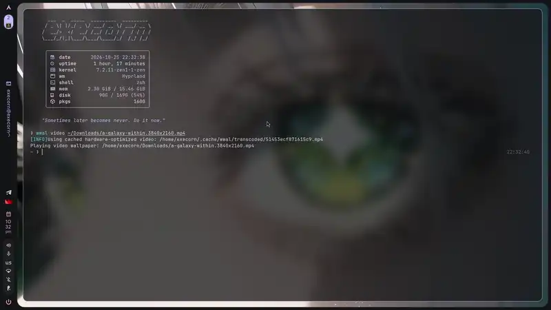

# `WayWal` (`wwal`): Modern C23 Wayland Wallpaper, Video, Shader & Theme Engine

[](https://github.com/execorn/wwal)

<p align="center">
  <a href="assets/demo.mp4">
    
  </a>
</p>

**WayWal** (`wwald` daemon and `wwal` CLI) is a fast, low-memory Wayland desktop engine written in modern C (C23 / `gnu2x`). It replaces six separate tools (`swww`/`awww`, `hyprpaper`, `mpvpaper`, `wpaperd`, `shaderbg`/`glava`, and `matugen`/`wallust`) inside one `< 1.5 MB` binary.

Repository: [https://github.com/execorn/wwal](https://github.com/execorn/wwal)

---

## Why Use WayWal?

- **Zero-Copy Direct Scanout**: Renders static wallpapers into GPU DMA-BUFs (`zwp_linux_dmabuf_v1` with linear, NVIDIA block-linear, AMD DCC, and Intel CCS modifiers) and 1×1 solid color buffers (`wp_single_pixel_buffer_v1`) with **0.0% GPU 3D load**.
- **True Physical HiDPI Sharpness**: Binds `wp_fractional_scale_v1` and `wp_viewporter` so 4K and 5K monitors at `1.25x`, `1.5x`, or `1.75x` scale render at exact physical pixel dimensions without blurry upscaling.
- **Hardware Video & Native Animations**: Plays H.264, HEVC, VP9, and AV1 videos with zero FFmpeg runtime dependencies using VA-API (`libva`), direct `NV12`/`P010` KMS scanout on Intel/AMD, a 3-surface `BGRX` VPP ring on NVIDIA, and an in-process GIF/APNG/WebP delta-frame engine.
- **Zero-Watt Smart Occlusion & Battery Governor**: Pauses video and shader rendering down to **0.00% CPU and GPU** when a monitor has a fullscreen or maximized window (`ext-foreign-toplevel-list-v1` + Hyprland/Sway IPC), when the session is idle (`ext-idle-notify-v1`), or when running on laptop battery power.
- **Live Shadertoy & Audio-Reactive Wallpapers**: Runs GLSL ES 3.1 `.comp` and Shadertoy `.frag` shaders (`wwal shader`) with a binary shader cache (`< 0.08 ms` warm load), live `inotify` hot-reload, and a lock-free PipeWire 2048-point AVX2 64-bin Bark-scale audio FFT (`--audio`).
- **Sub-Millisecond Material You & Quickshell (`caelestia`) Theming**: Extracts Material Design 3 (`CAM16`/`HCT`) and `OKLab` palettes from 4K images in **0.32 ms** using AVX2 Wu 3D moment quantization and weighted K-Means++, writing `~/.local/state/caelestia/scheme.json`, `~/.cache/wwal/colors.{json,css,hyprland.conf}`, and `/dev/pts/*` terminal OSC sequences.
- **100% Drop-In `swww` / `awww` Compatibility**: Works as a drop-in replacement for `swww` and `awww` scripts (`waypaper`, Rofi pickers) and decodes PNG, JPEG, BMP, WebP, AVIF (including macOS Solar Dynamic multi-frame files), JPEG-XL, GIF, APNG, and SVG.

> [!TIP]
> WayWal runs 18 built-in transition shaders on the GPU via OpenGL ES 3.1 compute shaders (`0.09–0.17 ms` at 1080p, `0.20–0.41 ms` at 4K) and includes an OpenMP + AVX-512 / AVX2 / NEON CPU fallback engine that renders 720p transitions at **1,548 – 26,087 FPS**.

---

## Installation & Quickstart

### Build from Source

```bash
git clone https://github.com/execorn/wwal.git
cd wwal

# Configure release build with Link-Time Optimization (LTO)
meson setup build --buildtype=release -Doptimization=3 -Db_lto=true

# Compile wwald (daemon) and wwal (client)
ninja -C build

# Run all unit, integration, fuzz, and E2E test suites
meson test -C build --print-errorlogs

# Install binaries to ~/.local/bin
install -m 755 build/wwal build/wwald ~/.local/bin/
```

### Distribution Packages

- **Arch Linux (`PKGBUILD`)**:
  ```bash
  cd contrib && makepkg -si
  ```
- **NixOS / Home Manager (`flake.nix`)**:
  ```bash
  nix run github:execorn/wwal -- query
  ```
- **Fedora / RHEL**: Build with `contrib/fedora/wwal.spec`.
- **Debian / Ubuntu**: Build with `contrib/debian/`.
- **Alpine Linux**: Build with `contrib/alpine/APKBUILD`.
- **Void Linux**: Build with `contrib/void/template`.

### Common Commands

```bash
# Start the daemon (or enable systemd socket activation: systemctl --user enable --now wwald.socket)
wwald &

# Set a wallpaper with a radial ripple transition from the mouse cursor and generate a Material 3 theme
wwal img ~/Pictures/Wallpapers/scenery.jpg --transition-type ripple --transition-pos cursor --theme

# Set a wallpaper with ablurred overview backdrop for the Niri compositor
wwal img ~/Pictures/Wallpapers/scenery.jpg --backdrop auto-blur

# Play a hardware-accelerated 4K video wallpaper
wwal video ~/Videos/loop.mp4

# Run an audio-reactive Shadertoy wallpaper with live PipeWire FFT
wwal shader ./my_shader.frag --audio --fps 60

# Extract and apply a Material Design 3 / Quickshell (caelestia) color scheme
wwal theme ~/Pictures/Wallpapers/scenery.jpg

# Inspect live daemon memory, DRM format/modifier, VBlank PLL jitter, and pause state
wwal stats

# Restore saved per-monitor wallpapers after login or hotplug
wwal restore
```

---

## Configuration (`~/.config/wwal/config.toml`)

WayWal works with zero configuration out of the box. You can optionally create `~/.config/wwal/config.toml` to set persistent defaults:

```toml
[daemon]
layer = "background"              # "background" or "bottom"
namespace = "waywal"              # Layer surface namespace
battery_policy = "reduce-fps"     # "ignore", "reduce-fps" (24 fps), or "pause-video"
auto_pause_fullscreen = true      # Pause video/shaders when a window is fullscreen
auto_pause_maximized = false
idle_timeout_sec = 300            # Pause animations when session is idle
ten_bit = false                   # Enable 10-bit XRGB2101010 scanout
backdrop = "none"                 # "none", "auto-blur" (for Niri overview), or file path

[theme]
enabled = true                    # Extract Material 3 palette on every wallpaper change
mode = "dark"                     # "dark" or "light"
caelestia_sync = true             # Write ~/.local/state/caelestia/scheme.json
tty_sequences = true              # Broadcast OSC 4/10/11 palette to active /dev/pts/* terminals

[transition]
type = "grow"
duration = 1.0
fps = 120
bezier = [0.25, 0.1, 0.25, 1.0]

[output."DP-1"]
path = "~/Pictures/Wallpapers/ultrawide.jxl"
scaling = "fill"
```

---

## CLI Reference (`wwal`)

```text
Usage: wwal [GLOBAL_OPTIONS] <COMMAND> [ARGS...]

Commands:
  img <PATH|-> [OPTIONS]     Load and set wallpaper (supports PNG, JPEG, WebP, AVIF, JXL, SVG, GIF, APNG)
  video <PATH> [OPTIONS]     Play hardware-accelerated video wallpaper (H.264, HEVC, VP9, AV1)
  shader <PATH> [OPTIONS]    Run live GLSL ES 3.1 (.comp) or Shadertoy (.frag) wallpaper
  slideshow <DIR> [OPTIONS]  Start zero-idle-CPU timerfd wallpaper slideshow
  slideshow <ACTION>         Control slideshow: stop, pause, resume, toggle, next, prev
  theme [PATH] [OPTIONS]     Extract < 0.4ms OKLab/HCT Material 3 palette & sync caelestia/terminals
  clear [COLOR]              Set solid hex color via 1x1 wp_single_pixel_buffer_v1
  restore                    Restore saved per-output wallpapers from state.bin
  stats                      Show live daemon RSS, DRM modifier, VBlank PLL, and pause telemetry
  query                      List connected Wayland outputs, physical/logical geometry, and scale
  pause / resume / toggle    Control active video or shader playback
  clear-cache                Purge cached video transcodes and compiled shader binaries
  ping                       Check if wwald daemon is responsive
  kill                       Terminate the running wwald daemon

Key Options:
  --transition-type <TYPE>   none, simple, fade, wipe, grow, outer, wave, noise, crosszoom,
                             slide, glitch, burn, ripple, pixelate, doom, swirl, cube, luma,
                             light_leak, page_curl, custom, left, right, top, bottom, center, any, random
  --transition-bezier <B>    Cubic bezier control points X1,Y1,X2,Y2 (e.g. 0.25,0.1,0.25,1.0)
  --transition-pos <POS>     cursor, center, tl, tr, bl, br, top, bottom, left, right, or X,Y
  --scaling-mode, --resize   fill (crop), fit, stretch, center (no), tile
  --fill-color <RRGGBB>      Padding color for fit/center modes
  --filter <FILTER>          Nearest, Bilinear, CatmullRom, Mitchell, Lanczos3
  --backdrop <MODE>          none, auto-blur (Dual-Kawase blur for Niri overview), or image path
  --layer <LAYER>            background or bottom
  --battery-policy <POLICY>  ignore, reduce-fps, or pause-video
  --audio                    Enable PipeWire 64-bin Bark FFT uniforms & iChannel0 for shaders
  --theme / --no-theme       Enable or disable automatic Material 3 / caelestia theme extraction
  --10bit                    Enable 10-bit wide-gamut scanout (XRGB2101010 / ARGB2101010)
```

---

## Repository Structure

```text
wwal/
├── README.md                          # Project overview, usage, and benchmarks
├── docs/
│   └── man/                           # scdoc manual pages (wwal.1, wwald.1, wwal-config.5)
├── flake.nix                          # NixOS Flake package, devShell, and Home Manager module
├── meson.build                        # Meson build configuration and test targets
├── contrib/
│   ├── PKGBUILD                       # Arch Linux package build script
│   ├── fedora/wwal.spec               # Fedora / RPM spec file
│   ├── debian/                        # Debian / Ubuntu packaging
│   ├── alpine/APKBUILD                # Alpine Linux package build script
│   ├── void/template                  # Void Linux xbps-src template
│   ├── systemd/                       # wwald.service and wwald.socket user units
│   └── completions/                   # Bash, Zsh, and Fish completions
├── protocols/                         # Bundled Wayland XML protocol definitions
├── include/waywal/                    # Public subsystem headers
├── src/
│   ├── common/                        # Arena, IPC, Bezier, OKLab/HCT palette, TOML, state store
│   ├── daemon/                        # Wayland core, GBM/DMA-BUF, VA-API, Shaders, Audio FFT, Power Gov
│   └── client/                        # CLI parser (wwal + swww/awww), multi-format image loader
└── tests/                             # Unit, subsystem, LibFuzzer, and E2E test suites
```

---

## Performance Benchmarks

Measured with `./build/bench_transitions 60` (`OMP_NUM_THREADS=4`):

| Subsystem / Kernel | Resolution | Latency / Frame Time | Throughput / Budget |
| :--- | :--- | ---: | :--- |
| **GPU Compute Transitions (18 Shaders)** | `1920×1080` | `0.094 – 0.175 ms` | **5,714 – 10,609 FPS** (`0 KB` leak) |
| **GPU Compute Transitions (18 Shaders)** | `3840×2160` (4K) | `0.203 – 0.411 ms` | **2,431 – 4,937 FPS** (`0 KB` leak) |
| **CPU OpenMP + AVX2 Transitions** | `1280×720` | `0.038 – 0.646 ms` | **1,548 – 26,087 FPS** |
| **OKLab Wu + K-Means++ + HCT Palette** | `3840×2160` (4K) | `0.325 ms` | **< 0.40 ms target** (`~500×` faster than external CLI) |
| **2048-pt Hann AVX2 64-Bin Bark FFT** | `48 kHz` PCM | `0.012 ms` | **< 0.015 ms target** (lock-free SPSC ring) |
| **Hardware VA-API Video Playback** | `1080p` / `4K` | `0.3%` CPU | **0.00% CPU/GPU when occluded** |

---

## Contributing & Verification

> [!IMPORTANT]
> If you edit any standalone compute shader in `src/daemon/shaders/*.comp`, update its matching `SHADER_SRC_*` string in `src/daemon/shaders/shaders_embedded.h`. The `waywal:e2e` test suite verifies byte-for-byte equality between the standalone `.comp` files and `shaders_embedded.h`.

Run the full test suite before submitting pull requests:

```bash
ninja -C build
meson test -C build --print-errorlogs
OMP_NUM_THREADS=4 ./build/bench_transitions 60
```
